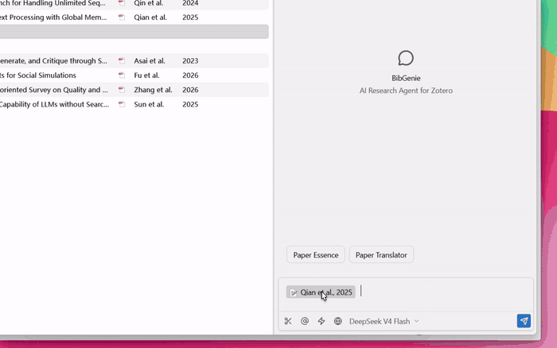
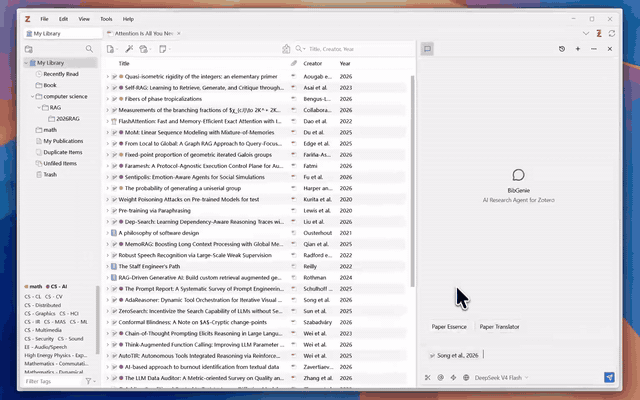
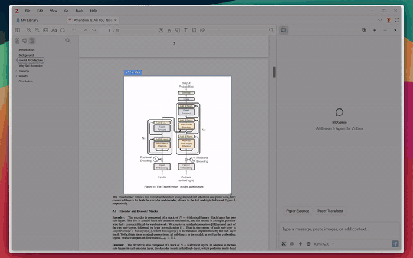
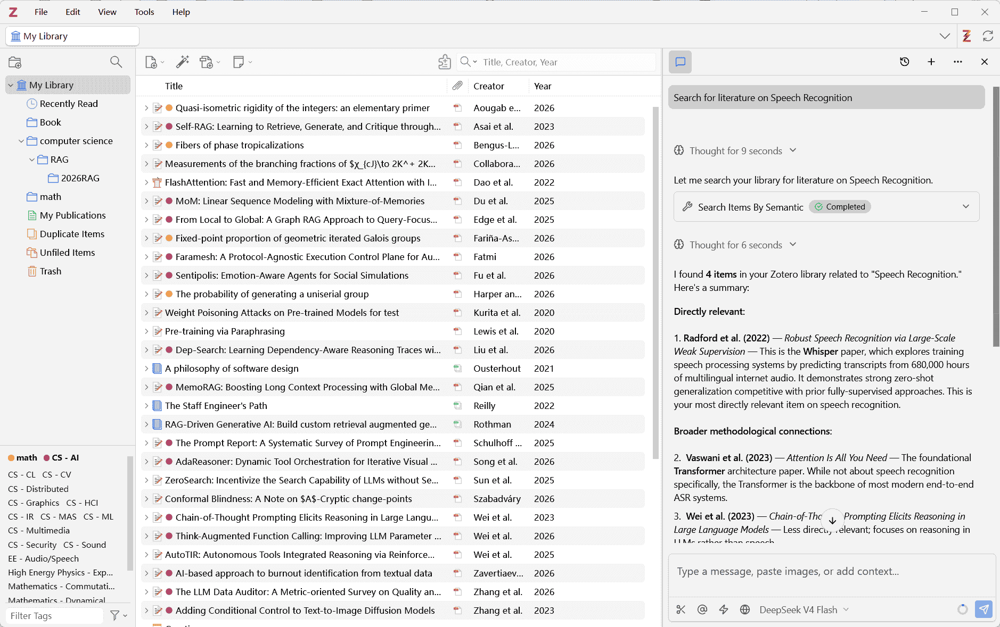
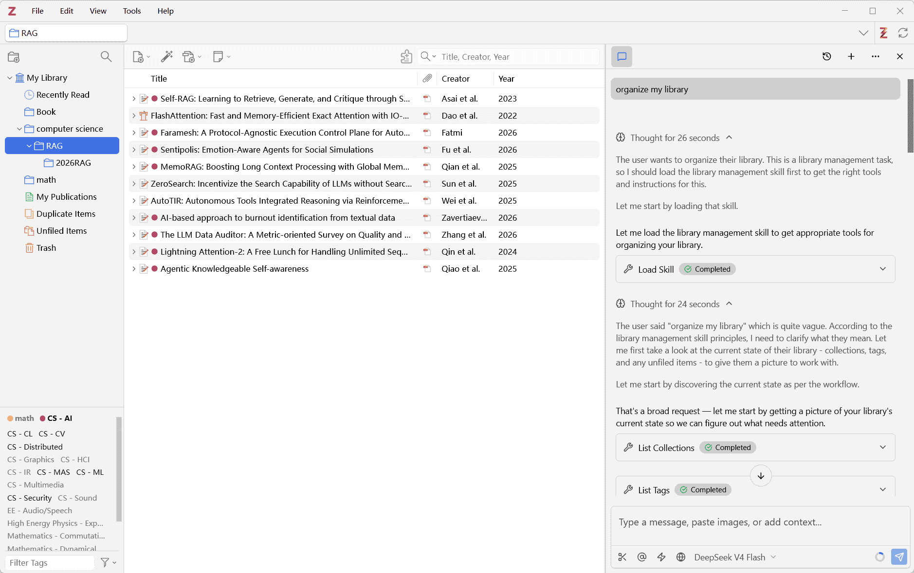

  

  # BibGenie

  ### AI Research Agent for Zotero

  [English](README.MD) | [简体中文](README_ZH.MD)

  
  
  
  
  
  

  > **Let AI handle the materials. Leave the understanding to the researcher.**

  **BibGenie works natively inside Zotero with your papers, notes, snapshots, annotations, and library structure. Add research context, ask grounded questions, trace claims back to primary passages, search and organize your library, and preserve insights back to Zotero and Notion.**

  [Download Free Plugin](https://www.bibgenie.com/download) · [Documentation](https://www.bibgenie.com/docs) · [About BibGenie](https://www.bibgenie.com/about) · [Join Discord](https://discord.gg/kDXFAAYDNE)

---

## Why BibGenie?

As language models advance, summarizing a hundred papers has become deceptively easy. Yet an elegant summary is not proof that genuine understanding has occurred. Every sentence may sound fluent and plausible, but scholarly rigor requires checking: *Where does this conclusion originate? What empirical evidence was presented? Under what conditions does it hold? What counterexamples might challenge it?*

BibGenie lives in your Zotero sidebar to assist with the friction of research—locating materials, comparing methods, and synthesizing evidence—while keeping you connected to the primary text.

  
   
  Research workflow preview: add context, read a paper, and save the result. <a href="https://cfr2.bibgenie.com/bibgenie-mp4s/add_context_read_save_lq.mp4">View full-quality video</a>

---

## Core Capabilities

### 1. Add Any Zotero Context
Bring your actual workspace into the discussion rather than copying excerpts into an isolated web chatbot:
- Type `@` or choose **Add to Chat** from the Library or Reader to attach items, PDF attachments, web snapshots, notes, tags, and collections.
- Select passages, active page context, figures, formulas, or pasted screenshots.
- Discuss difficult diagrams and mathematical proofs directly inside the Zotero reader.

  
   
  Add Zotero material with <code>@</code>. <a href="https://cfr2.bibgenie.com/bibgenie-mp4s/at_any_context.mp4">View full-quality video</a>

  
   
  Discuss figures and screenshots in the reader. <a href="https://cfr2.bibgenie.com/bibgenie-mp4s/explain_image.mp4">View full-quality video</a>

### 2. Trace Every Claim to Its Source
- BibGenie places interactive citation markers beside the paragraphs they support.
- Click a citation marker to **jump straight back to the supporting passage in Zotero's PDF/EPUB reader with contextual highlighting**.
- Inspect nearby caveats, methodology details, and figures before adopting a conclusion, safeguarding your writing from AI hallucinations.

### 3. Search Your Library — Keyword & Semantic Indexing
- Find papers across fields like title, author, year, DOI, tag, collection, journal, or conference.
- Leverage the **local semantic vector index** of your library's titles and abstracts to discover conceptually relevant works without exact keyword matches.
- All vector indexing and searches happen locally on your computer.

  

### 4. Explore Beyond Your Library (OpenAlex & Web Research)
- **OpenAlex Academic Search**: Connect to hundreds of millions of scholarly metadata records worldwide to discover relevant papers outside your collection, navigate citation networks, and analyze research trends.
- **Web Search & Extract**: Retrieve timely live web information and extract structured text for emerging interdisciplinary questions.

### 5. Organize Your Library — with Preview-First Safety
- Organize tags, restructure collections, and clean up inconsistent metadata across items.
- **Explicit Human Approval**: For any operation that modifies your library database, BibGenie first presents an approval card displaying the proposed plan, affected items, and field changes. Nothing is written until you explicitly click approve.

  

### 6. Preserve Insights to Zotero & Notion
- **Save as Note**: Save multi-paper comparisons, synthesis tables, and research insights directly as attached or standalone Zotero notes.
- **Notion Integration**: Connect your authorized Notion workspace via Notion MCP to search and sync literature notes directly into your broader knowledge base.

### 7. Local Zotero MCP Server
- BibGenie includes a built-in local **Model Context Protocol (MCP)** server.
- Connect external AI coding and research tools—such as **Cursor, Claude Desktop, Claude Code, and Cherry Studio**—to your local Zotero context, enabling them to search items, read attachments, and draft notes securely.

### 8. Flexible Models & Local-First Privacy
- **Instant Start**: Try curated managed models right away with monthly credits; no initial API key setup required.
- **Custom Models**: Bring your own API key for OpenAI, Anthropic, DeepSeek, Google Gemini, OpenRouter, Groq, or any OpenAI-compatible provider. Requests travel directly between your machine and your provider.
- **Offline Local Inference**: Connect to local Ollama or LM Studio runtimes. Sensitive research data never leaves your device.
- **Local Storage**: Chat records and index caches remain stored locally in your Zotero profile database.

---

## Installation

### Requirements
- **Zotero 7, Zotero 8, Zotero 9, or Zotero 10**
- Windows, macOS, or Linux

### Quick Setup
1. Download the latest `.xpi` file from the [BibGenie Download Page](https://www.bibgenie.com/download) or [GitHub Releases](https://github.com/BaiRuic/BibGenie/releases).
2. In Zotero, go to **Tools -> Plugins**.
3. Click the gear icon in the top right and select **Install Plugin From File...**.
4. Choose the downloaded `bibgenie-<version>.xpi` file, confirm the installation, and restart Zotero.
5. Open BibGenie from the Zotero toolbar or **Tools -> BibGenie**.

BibGenie checks for updates when Zotero starts, or you can enable automatic updates via Zotero's Plugin Manager.

---

## Documentation

- [Getting Started Guide](https://www.bibgenie.com/docs/getting-started)
- [Traceable Citations & Navigation](https://www.bibgenie.com/docs/bibgenie-citations)
- [Adding Research Context](https://www.bibgenie.com/docs/add-context)
- [Semantic Library Indexing](https://www.bibgenie.com/docs/semantic-index)
- [Literature Search](https://www.bibgenie.com/docs/literature-search)
- [OpenAlex Academic Search](https://www.bibgenie.com/docs/openalex-research)
- [Custom Models & API Keys](https://www.bibgenie.com/docs/custom-models)
- [Local Zotero MCP Server](https://www.bibgenie.com/docs/mcp)
- [Zotero to Notion Workflow](https://www.bibgenie.com/docs/zotero-to-notion)
- [Pricing and Credits](https://www.bibgenie.com/docs/pricing-credits)

---

## About This Repository

This repository hosts official product information, issue tracking, and downloadable releases for BibGenie. The internal application source code is not published in this public repository.

## Community & Support

- Website: [www.bibgenie.com](https://www.bibgenie.com)
- Documentation: [www.bibgenie.com/docs](https://www.bibgenie.com/docs)
- Discord: [Join our Community](https://discord.gg/kDXFAAYDNE)
- Email: [support@bibgenie.com](mailto:support@bibgenie.com)

  <strong>Bring your Zotero library into an AI-native research workflow.</strong>
    
  <a href="https://www.bibgenie.com/download"><strong>Download BibGenie</strong></a>

